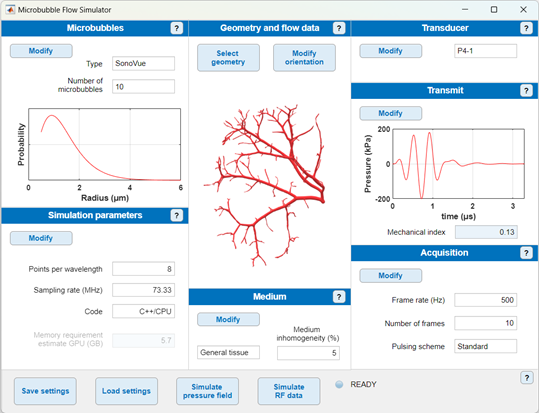

Lorem ipsum dolor sit amet, consectetur adipiscing elit. Sed do eiusmod tempor incididunt ut labore et dolore magna aliqua.

Imaging applications are described in [Part II](https://doi.org/10.1109/TUFFC.2025.3566437).
